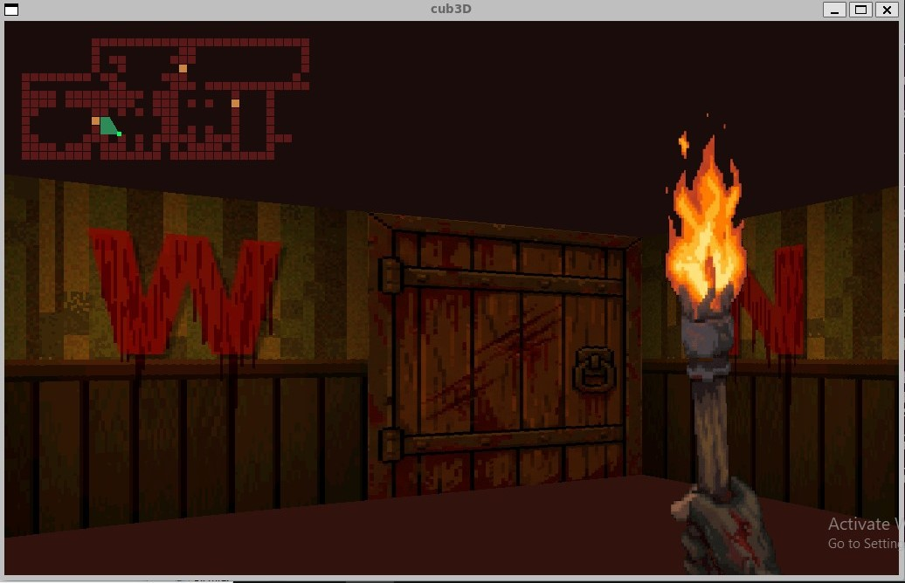

*This project has been created as part of the 42 curriculum by aalrofat, hsbeh.*

# cub3D - 3D Horror Maze Game



## Description (About The Project)
**cub3D** is our first 3D graphical project at 42 Amman, built in C using the **MiniLibX** library. The main idea of this project is to create a 3D maze from a 2D map using **Raycasting (DDA Algorithm)**, similar to the classic *Wolfenstein 3D* game.

We chose a **dark horror maze theme** for our project, where the player explores the maze carrying a flickering torch.

## What We Built

### 1. Mandatory Part
* **Map Parsing:** Reading and checking the `.cub` file to make sure the textures (`NO`, `SO`, `WE`, `EA`), floor and ceiling colors (`F`, `C`), and walls are all valid and closed properly.
* **Raycasting (DDA):** Sending rays from the player's position to find the distance to the walls and calculate the height of each wall slice on the screen.
* **Fisheye Fix:** Fixing the curved wall distortion using cosine math so the walls look straight and natural.
* **Wall Textures:** Drawing the right texture (`north`, `south`, `east`, `west`) depending on which side of the wall the ray hits.
* **Player Movement:** Moving smoothly with `W`, `A`, `S`, `D` and rotating the camera with the `Left` and `Right` arrow keys.

### 2. Bonus Part
* **Wall Collision:** The player stops when hitting a wall (`1`) or a closed door (`D`) instead of walking through them.
* **2D Minimap & Rays:** A small map in the top-left corner that shows the walls, doors, the player's position, and the green field-of-view (FOV) ray.
* **Doors (`D` / `O`):** The player can stand in front of a door and press `K` to open or close it.
* **Mouse Rotation:** Looking left and right smoothly by moving the mouse.
* **Animated Torch & Light Effect:** A 3-frame animated torch in the player's hand, with a warm light effect that makes close walls brighter and far walls darker.

## Instructions (How to Run the Game)

### 1. Compilation & Execution

**Mandatory Version:**
```bash
make
./cub3D maps/mandatory.cub
```

**Bonus Version:**
```bash
make bonus
./cub3D_bonus maps/bonus.cub
```

### 2. Game Controls

| Key | Action |
| :--- | :--- |
| **`W` / `S`** | Move forward and backward |
| **`A` / `D`** | Move left and right |
| **`Left` / `Right` Arrows** | Turn camera left and right |
| **`Mouse Move`** | Turn camera left and right (Bonus) |
| **`K`** | Open and close doors (Bonus) |
| **`ESC` or `X` button** | Close the game cleanly |

---

## Resources & References
* **[So-Long 42 project](https://cdn.intra.42.fr/pdf/pdf/220244/en.subject.pdf)** : Used as a core reference and foundation for map parsing logic, file reading, and error handling.
* **[What is RayCasting](https://42-fran-byte-f94097.gitlab.io/docs/cub3d/cub3d-approach-en/#/).**


* **AI Usage:**
  * Generating custom pixel-art textures for the walls, doors, and the 3 torch frames (`torch1.xpm`, `torch2.xpm`, `torch3.xpm`).
  * Helping with English translation and formatting for this `README.md` file.
  * All the C code, parsing logic, raycasting math, and memory management were written and tested by us.

